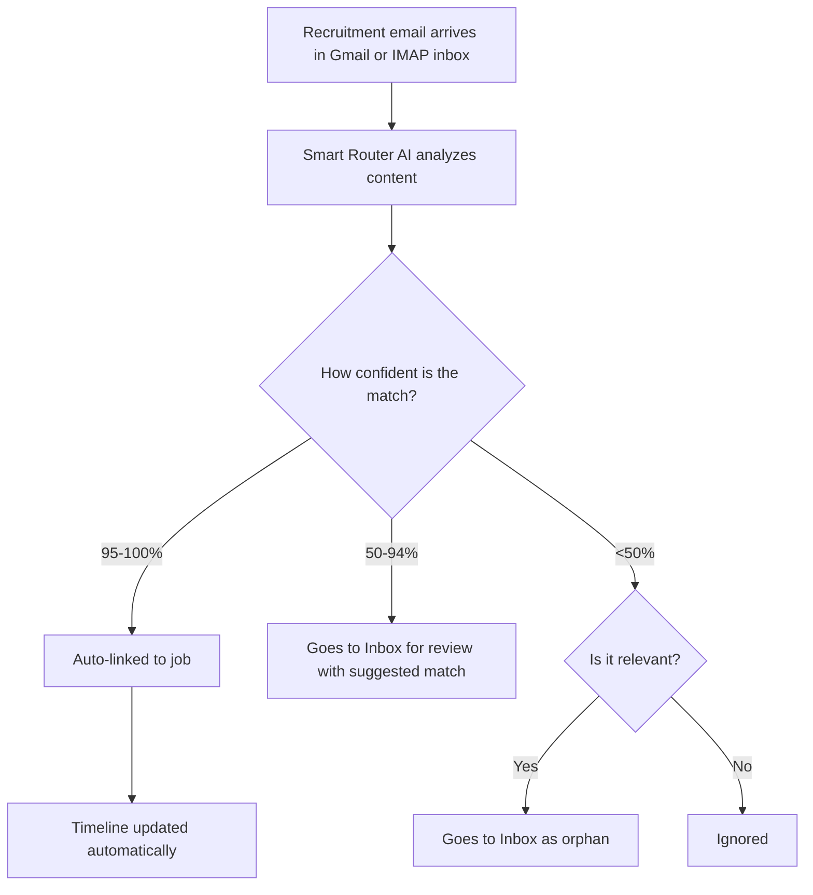

The Tracking Inbox monitors a Gmail or IMAP mailbox for job-application responses and updates timelines.


## Overview

1. Scans your Gmail or IMAP inbox for recruitment-related emails
2. Matches emails to tracked jobs using AI
3. Updates timeline/state when confidence is high
4. Queues uncertain matches for manual review

## Smart router flow



## Setup

Pick one provider in **Tracking Inbox → Provider Controls**: `gmail` or `imap`.

### Gmail

#### Prerequisites

1. Gmail account with application emails
2. Google OAuth credentials

#### Configure OAuth

Set:

```bash
GMAIL_OAUTH_CLIENT_ID=your-client-id.apps.googleusercontent.com
GMAIL_OAUTH_CLIENT_SECRET=your-client-secret
GMAIL_OAUTH_REDIRECT_URI=https://your-domain.com/oauth/gmail/callback
```

Then connect in UI via **Tracking Inbox → Connect Gmail**.

Detailed setup guide:

- [Gmail OAuth Setup](/docs/next/getting-started/gmail-oauth-setup)

### IMAP

Use IMAP for any mailbox reachable over IMAP, such as an MxRoute mailbox. No OAuth setup is needed.

1. Open **Tracking Inbox → Provider Controls**.
2. Set **Provider** to `imap`.
3. Fill in **Host**, **Port**, **Use TLS**, **Username** and **Password**.
4. Connect. JobOps tests the login first and only saves the account if it succeeds.

MxRoute example:

| Field     | Value                                                   |
| --------- | ------------------------------------------------------- |
| Host      | `<your-server>.mxrouting.net` (your MxRoute server name) |
| Port      | `993`                                                   |
| Use TLS   | on                                                      |
| Username  | the full email address, such as `you@example.com`       |
| Password  | that mailbox's password                                 |

Defaults and constraints:

- Port defaults to `993` and **Use TLS** defaults to on (implicit TLS).
- Turning **Use TLS** off still requires STARTTLS, so the password never travels unencrypted. Certificate validation stays on.
- Host must be a bare hostname: no `https://`, path or spaces.
- Max Messages and Search Days apply to IMAP as they do to Gmail. IMAP defaults are 100 messages and 90 days.

### IMAP sync limits

- Each message is capped at 1 MiB; larger messages are truncated to 1 MiB.
- Each sync run fetches at most 32 MiB in total. Once that budget is used, the remaining messages are skipped for that run and a warning is logged.
- The limits are `IMAP_MAX_MESSAGE_BYTES` and `IMAP_MAX_SYNC_BYTES` in `orchestrator/src/server/services/post-application/ingestion/imap-client.ts`. They are fixed constants, not settings.

## Using the inbox

- Review pending items in Tracking Inbox
- Approve to link/update timeline
- Ignore to mark non-relevant

## Job emails tab

Open **Job → Emails** to review captured messages already linked to that job.

The tab is read-only. It shows stored metadata only: sender, subject, received
time, snippet, processing status, message type, match confidence, account label,
and a Gmail thread link when the stored message includes a Gmail thread ID.

It does not store full email bodies, re-fetch from Gmail, or expose review
actions. Use **Tracking Inbox** for approve/ignore decisions.

Confidence interpretation:

- `95-100%`: auto-processed
- `50-94%`: pending review with suggestion
- `<50%`: pending review as orphan/ignored

## Privacy and security

### Gmail

- Scope requested: `gmail.readonly`
- Full scope: `https://www.googleapis.com/auth/gmail.readonly`
- Minimal metadata sent for matching
- Email data stays local in your instance

### IMAP

- Only `INBOX` is scanned; other folders are not.
- `INBOX` is opened read-only and messages are fetched with `BODY.PEEK[]`, so messages are never marked read, moved or deleted.
- The password is stored encrypted with AES-256-GCM and is never returned by the API (status shows host, port, TLS, username and whether a password is saved).
- The encryption key comes from `CREDENTIALS_ENCRYPTION_KEY` (at least 32 characters). If it is unset, a key is generated and saved at `DATA_DIR/credentials-key`.
- Losing or changing the key means you must reconnect your IMAP accounts.

Example, generated with `openssl rand -base64 48`:

```bash
CREDENTIALS_ENCRYPTION_KEY=<output of: openssl rand -base64 48>
```

## API reference

| Method | Endpoint                                  | Description           |
| ------ | ----------------------------------------- | --------------------- |
| GET    | `/api/post-application/inbox`             | List pending messages |
| POST   | `/api/post-application/inbox/:id/approve` | Approve message       |
| POST   | `/api/post-application/inbox/:id/deny`    | Ignore message        |
| GET    | `/api/post-application/runs`              | List sync runs        |
| GET    | `/api/jobs/:id/emails?limit=100`          | List job-linked email metadata |
| GET    | `/api/post-application/providers/gmail/oauth/start` | Start OAuth flow |
| POST   | `/api/post-application/providers/gmail/oauth/exchange` | Exchange OAuth code |
| POST   | `/api/post-application/providers/imap/actions/connect` | Connect IMAP mailbox (tests login first) |
| POST   | `/api/post-application/providers/imap/actions/status` | IMAP connection status |
| POST   | `/api/post-application/providers/imap/actions/sync` | Run IMAP sync |
| POST   | `/api/post-application/providers/imap/actions/disconnect` | Disconnect IMAP mailbox |

## Common issues

- No refresh token: disconnect and reconnect Gmail.
- Emails not appearing: check runs, OAuth config, and recruitment subjects.
- Wrong matches: expected in lower-confidence buckets; use manual review.

### IMAP

- "IMAP login failed. Check the username and password.": use the full email address as username and re-check the password.
- "Could not reach the IMAP server at host:port.": check the host (bare hostname), port, and that Use TLS matches the server (993 with TLS, or STARTTLS if TLS is off).
- Only part of the inbox synced, or a large message looks cut off: messages are capped at 1 MiB and a sync fetches at most 32 MiB. Narrow `searchDays` / `maxMessages`, or sync again.
- IMAP accounts show as disconnected after a key change: reconnect them; the old encrypted passwords cannot be decrypted with a new `CREDENTIALS_ENCRYPTION_KEY`.
- Connect and sync are disabled in the public demo.
